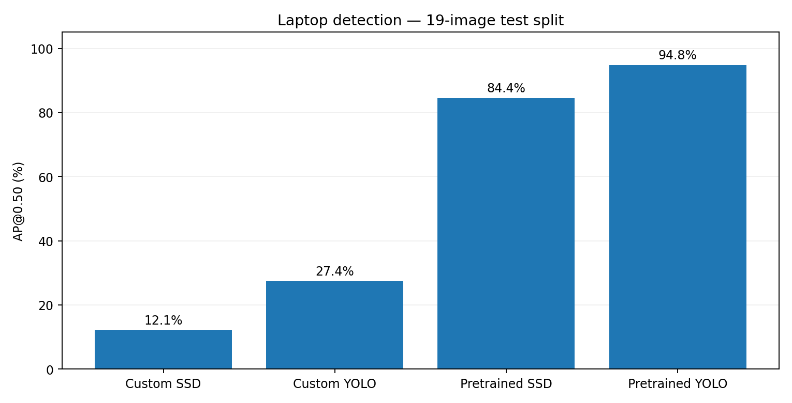
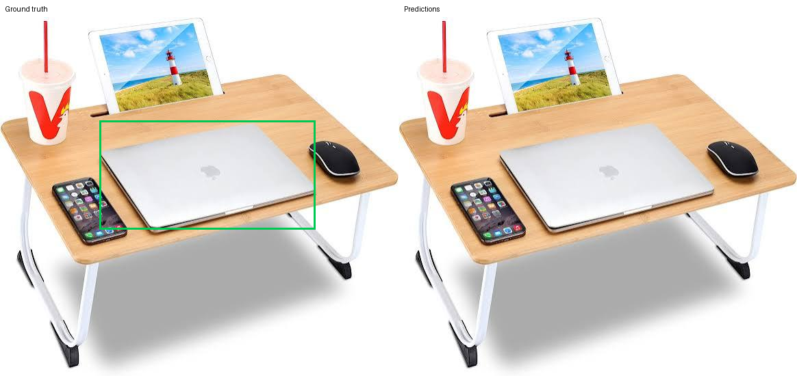
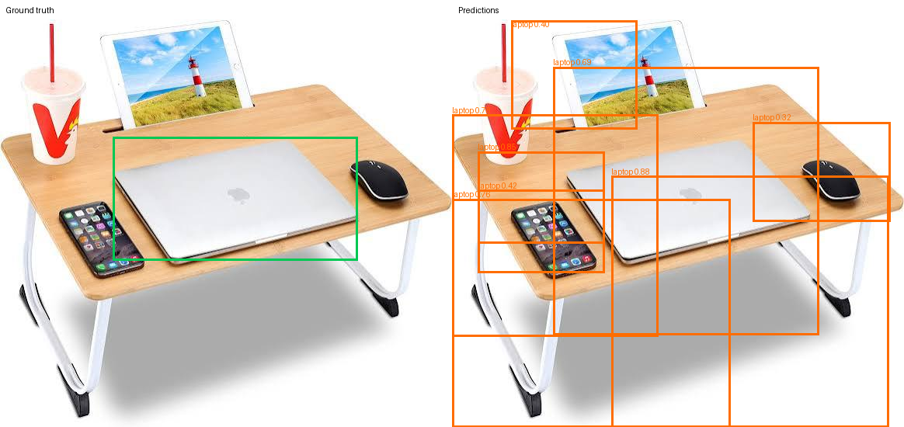
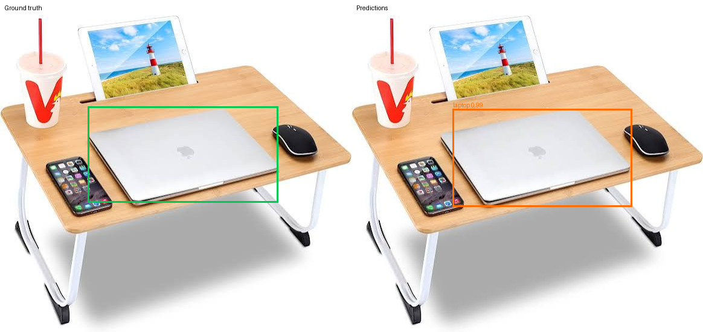
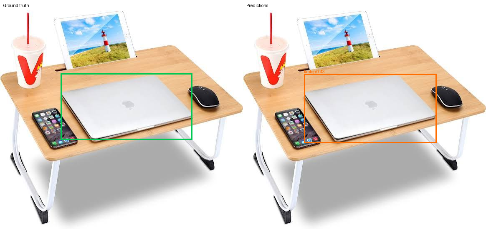

# Laptop Object Detection with SSD and YOLO

A reproducible PyTorch project comparing **four laptop object detectors** on the same labeled dataset: a custom SSD, a custom YOLO-style network, a COCO-pretrained SSD300-VGG16, and a COCO-pretrained YOLO11n.

The repository includes the detector implementations, COCO annotations, training and evaluation scripts, a Jupyter notebook, experiment metrics, and representative prediction images. **The original photographs and trained weight files are not committed.**

## Results

All four models completed **15 training epochs** on a common split of **67 training, 8 validation and 19 test images**. The test set contains **20 labeled laptop instances**.

| Model | AP@0.50 / mAP@0.50 | Precision | Recall | TP | FP | FN |
|---|---:|---:|---:|---:|---:|---:|
| Custom SSD | 12.06% | 6.59% | 55.00% | 11 | 156 | 9 |
| Custom YOLO-style | 27.39% | 2.35% | 70.00% | 14 | 581 | 6 |
| Pretrained SSD300-VGG16 | 84.44% | **94.44%** | 85.00% | 17 | 1 | 3 |
| **Pretrained YOLO11n** | **94.75%** | 90.48% | **95.00%** | **19** | 2 | **1** |

> **Metric definition:** This is single-class, VOC-style **AP at IoU ≥ 0.50** (reported as mAP@0.50 because only one foreground category is evaluated), **not** COCO mAP@[0.50:0.95]. Precision and recall use a **0.05 confidence threshold** and one-to-one matching. The 19-image test set is too small for strong deployment or cross-domain generalization claims.



### Detection examples

| Custom SSD | Custom YOLO-style |
|:--:|:--:|
|  |  |

| Pretrained SSD | Pretrained YOLO |
|:--:|:--:|
|  |  |

The custom models reduced their training losses, but their test predictions still contained many false positives. The pretrained models performed considerably better on this small dataset. **Training loss should not be compared numerically between different model architectures as though it were a common accuracy metric.**

### Data-quality limitation

An inspection of the exported dataset detected **byte-identical photographs across data splits**: a train/validation duplicate and a validation/test duplicate. No byte-identical train/test pair was observed in that inspection. However, the validation/test overlap undermines the independence of the evaluation, especially when validation data influences checkpoint selection. Near duplicates may also exist. **The numbers above are the recorded baseline results, not a leakage-free benchmark.** Before publishing this as a robust benchmark, deduplicate at the image level, re-create the split, and rerun all four experiments.

## Architectures

| Experiment | Main components |
|---|---|
| `custom-ssd` | Lightweight convolutional backbone, three feature-map scales, SSD classification and box-regression heads, anchor/default boxes, matching loss and NMS |
| `custom-yolo` | Five-stage convolutional feature extractor with a 13×13 grid, three anchor predictions per cell, objectness/class/box outputs, custom loss and decoding |
| `pretrained-ssd` | Torchvision COCO-pretrained SSD300-VGG16 fine-tuned for background plus laptop |
| `pretrained-yolo` | Ultralytics YOLO11n initialized from `yolo11n.pt` and fine-tuned for a single laptop class |

The custom YOLO is a **compact YOLO-style architecture**, not an implementation of the full Ultralytics YOLO11 architecture.

## Dataset

The project uses the COCO annotations in `laptop_all_3_batches_COCO.json`:

- **94 images**, **100 labeled laptop instances** and **one foreground category**: `laptop`.
- COCO boxes are `[x, y, width, height]`; the loaders convert them to the box representation required by each detector.
- The original images belong in three folders: `raw_images/set1`, `raw_images/set2` and `raw_images/set3`.
- Torchvision detectors use label ID `1` for `laptop` (ID `0` reserved for background). The YOLO-format export uses class ID `0` for the sole class.

Place your local source files as follows, preserving subfolders and file names:

```text
SSD_YOLO_Laptop_Detection/
├── raw_images/                 # Not part of this repository
│   ├── set1/
│   ├── set2/
│   └── set3/
├── laptop_all_3_batches_COCO.json
├── models.py
├── dataset_utils.py
├── run_experiments.py
├── compare_results.py
├── Laptop_Detection_SSD_YOLO.ipynb
├── requirements.txt
├── results/                    # Selected lightweight metrics and plots only
└── tests/
```

Some batches have colliding photo file names, so **do not flatten the three source-image directories**. The actual JPGs are needed to reproduce training; COCO JSON alone is not sufficient. Respect source-image licenses when redistributing photos or example outputs.

## Windows setup (PowerShell)

Python 3.13 and CUDA-enabled PyTorch were used successfully in the reported environment. A supported Python version with compatible PyTorch/Torchvision wheels is required.

```powershell
py -3.13 -m venv .venv

.\.venv\Scripts\python.exe -m pip install --upgrade pip

.\.venv\Scripts\python.exe -m pip install torch torchvision --index-url https://download.pytorch.org/whl/cu126

.\.venv\Scripts\python.exe -m pip install -r requirements.txt
.\.venv\Scripts\python.exe -c "import torch; print(torch.__version__, 'CUDA:',torch.cuda.is_available())"
```

Use the official [PyTorch installation selector](https://pytorch.org/get-started/locally/) if the CUDA 12.6 build is unsuitable for your GPU driver, or install CPU wheels when no supported NVIDIA GPU is available. The first pretrained-model runs also need internet access to download model weights.

## Run the experiments

Commands below use the virtual environment's Python. Run them from the directory containing `run_experiments.py`.

```powershell
.\.venv\Scripts\python.exe run_experiments.py --report-dataset

.\.venv\Scripts\python.exe run_experiments.py --smoke

.\.venv\Scripts\python.exe run_experiments.py --prepare

.\.venv\Scripts\python.exe run_experiments.py --experiment custom-ssd --epochs 15 --batch-size 2
.\.venv\Scripts\python.exe run_experiments.py --experiment custom-yolo --epochs 15 --batch-size 4
.\.venv\Scripts\python.exe run_experiments.py --experiment pretrained-ssd --epochs 15 --batch-size 1
.\.venv\Scripts\python.exe run_experiments.py --experiment pretrained-yolo --epochs 15 --batch-size 4

.\.venv\Scripts\python.exe compare_results.py
```

If you already have a working `.venv`, you can skip environment creation and dependency installation. The four experiments train sequentially; they do not all need to fit into GPU memory simultaneously. If CUDA runs out of memory, reduce the relevant batch size.

## Project outputs

| File | Contents |
|---|---|
| `results/<model>/metrics.json` | AP@0.50, precision, recall, TP/FP/FN and experiment settings |
| `results/<model>/prediction.png` | Labeled ground-truth image compared with predicted boxes |
| `results/<model>/training_loss.png` | Training-loss curve for the custom/SSD models |
| `results/pretrained-yolo/results.png` | Ultralytics learning and validation curves |
| `results/comparison.csv` | Compact table of test metrics for all four experiments |
| `results/comparison.png` | Visual model comparison |
| `results/split_ids.json` | Image IDs for the fixed train/validation/test split |

The training scripts also generate `.pth` or `.pt` weights and an expanded `results/prepared_yolo/` dataset locally. These are excluded from this repository to avoid uploading large files and copied source images. For additional validation details, see [YOLO's precision–recall curve](results/pretrained-yolo/BoxPR_curve.png) and [confusion matrix](results/pretrained-yolo/confusion_matrix.png).

## Testing

```powershell
.\.venv\Scripts\python.exe -m pytest -q
```

The smoke test and unit tests verify implementation behavior; they do not replace measured detection accuracy on held-out photos.

## Reproducibility notes

- Fixed split seed: **42**. See `results/split_ids.json`.
- All reported experiments ran for **15 epochs**.
- The original images are not contained in this repository. Reproduction requires the source photographs with matching file names and annotations.
- The pretrained backbones were exposed to broad datasets before this fine-tuning, and laptops are represented in common object detection pretraining corpora.
- Some CUDA operations may not be deterministic even when the random seed is fixed.
- Results should be repeated on a deduplicated, larger held-out set before use as production performance claims.
